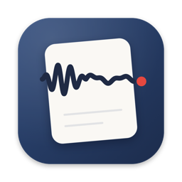

<div align="center">



<h1>Hushpad</h1>

<p>
  <b>Meeting notes that stay on your Mac.</b>
  <br />
  Hit record, have your meeting, get notes that say who's doing what.
  <br />
  No bot crashing your call. No account. No audio in someone else's cloud.
</p>

<p>
  <a href="https://github.com/kelyamany/Hushpad/actions/workflows/ci.yml"></a>
  <a href="LICENSE"></a>
  
  
</p>



</div>

## Why you'll like it

- 🤫 **No awkward bot in the call.** Hushpad listens from your own Mac, iPhone or Watch. Nobody sees an extra guest.
- 🔒 **Your voice stays home.** Speech turns into text right on your device. Your audio is never uploaded. Ever.
- ✍️ **Notes that get to the point.** Jot a few words while you listen. Afterwards you get a summary, the decisions,
  and the to-dos with names attached.
- 💬 **Ask anything.** "What did I miss?" in the middle of a meeting, or "What did we decide about pricing?" across all
  of them.
- 🌍 **Speaks your language.** Nearly 100 of them, even when a meeting hops between two.
- 📁 **Yours to keep.** Every meeting is a folder of ordinary files you can open, back up or take anywhere. Coming
  from Granola? Bring your old meetings with you.

## How it works

1. **Join your call.** A little tab at the edge of your screen asks whether to take notes. One click and you're recording.
2. **Listen, and scribble if you like.** Live captions keep up as people talk.
3. **Get your notes.** One click when you're done. Then ask follow-up questions, or copy the notes wherever they need to go.

## Get it

Hushpad isn't on the App Store yet, so you build it on your own Mac. It's free and takes a few minutes.

1. Install [Xcode](https://apps.apple.com/app/xcode/id497799835) and [XcodeGen](https://github.com/yonaskolb/XcodeGen)
   (`brew install xcodegen`).
2. Run these three lines in Terminal:

   ```bash
   git clone https://github.com/kelyamany/Hushpad.git
   cd Hushpad
   ./install.sh
   ```

The app opens by itself. Want it on your iPhone and Watch too? See [docs/DEVELOPMENT.md](docs/DEVELOPMENT.md).

For the AI notes, pick a free model that runs on your Mac ([LM Studio](https://lmstudio.ai) or
[Ollama](https://ollama.com)), or switch on a cloud model you choose. Cloud only ever gets text, and only when you ask.

## Be a good meeting buddy

Always tell people you're recording and get their OK. In some places that's the law.

## Privacy, in one breath

Nothing leaves your devices unless you switch on cloud notes, and even then it's only text, with people's names hidden.
Want more? Lock the app with Touch ID, encrypt your whole library, or let old audio delete itself.
The details are in [PRIVACY.md](PRIVACY.md).

## Join in

Ideas, bug reports and translations are all welcome: start with [CONTRIBUTING.md](CONTRIBUTING.md).
Found a security problem? See [SECURITY.md](SECURITY.md).

## Thanks

Hushpad is built on [WhisperKit and SpeakerKit](https://github.com/argmaxinc/argmax-oss-swift) by Argmax, OpenAI's
[Whisper](https://github.com/openai/whisper) and [pyannote](https://github.com/pyannote/pyannote-audio). The speaker
models are under [CC BY 4.0](https://creativecommons.org/licenses/by/4.0/). The idea owes a lot to
[Granola](https://granola.ai) and [anarlog](https://github.com/fastrepl/anarlog). Fonts:
[IBM Plex Serif](https://github.com/IBM/plex) and [Hanken Grotesk](https://github.com/marcologous/hanken-grotesk).

## License

[MIT](LICENSE): use it, change it, share it. Other people's work keeps its own licence; see
[THIRD_PARTY_NOTICES.md](THIRD_PARTY_NOTICES.md). Hushpad is an independent project, not affiliated with Granola or
Argmax.
